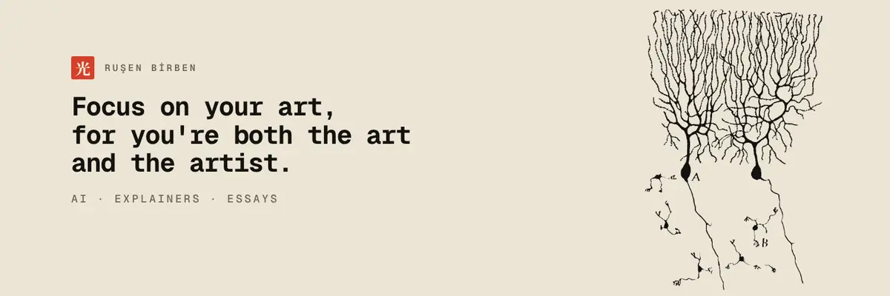
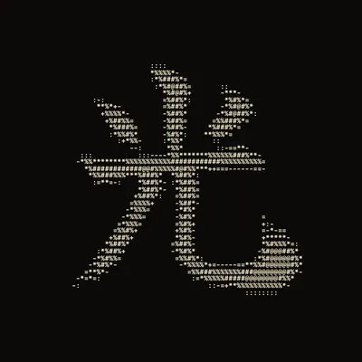
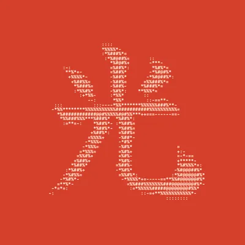
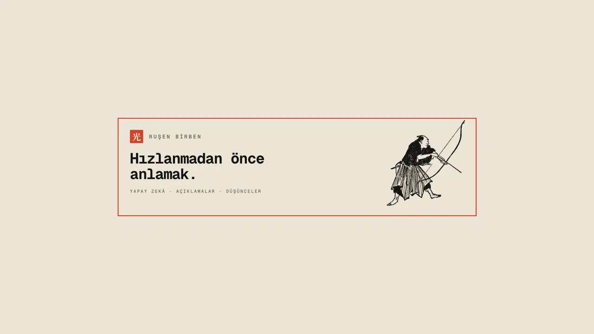
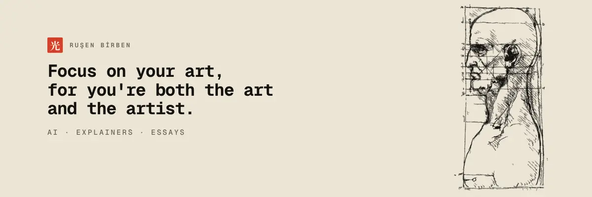
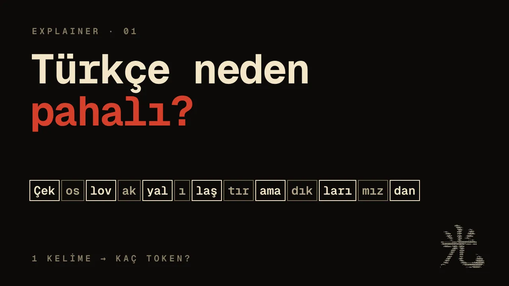
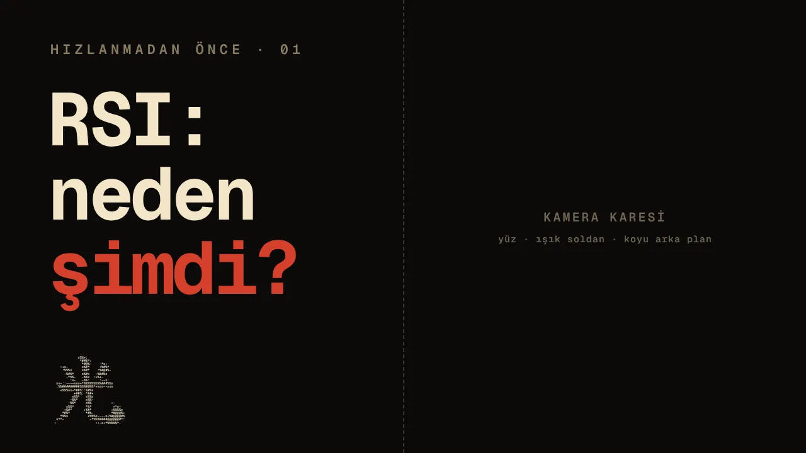

# Kişisel marka: Ruşen Birben

YouTube, X ve diğer hesaplarda kullanılan görsel sistem. Buradaki hiçbir şey sitenin build'ine girmez (`public/` dışında, lint'ten hariç).

**Söz (banner, İngilizce):** "Focus on your art, for you're both the art and the artist." Ruşen'in kendi cümlesi.
**İşaret:** 光 (hikari, "ışık"). Ruşen'in anlamı aydınlık.



## Palet

| Ad | Hex | Nerede |
| --- | --- | --- |
| Mürekkep | `#0b0a09` | Thumbnail ve avatar zemini |
| Mum ışığı | `#f3e6c8` | Koyu zemindeki ana yazı |
| Mühür | `#d6402b` | 光 mührü, başlıktaki vurgu kelimesi. Sayfa başına tek vurgu |
| Mühür yazısı | `#fff1dc` | Mührün içindeki 光 |
| Kâğıt | `#ece5d6` | Banner zemini |
| Kâğıt mürekkebi | `#14120f` | Banner'daki ana yazı |
| Soluk (koyu) | `#8a7d64` | Koyu zeminde etiket, alt yazı |
| Soluk (kâğıt) | `#6f6553` | Kâğıt zeminde etiket, alt yazı |

## Yazı

- **Geist Mono**: Bold (700) başlıklar, SemiBold (600) etiketler, Medium (500) alt yazılar. Başlıklarda hafif negatif harf aralığı, etiketlerde geniş harf aralığı ve BÜYÜK HARF.
- **Noto Serif JP** Bold: sadece mühürdeki 光 için.
- Serif başlık (EB Garamond vb.) kullanılmıyor. Son tipografi seçimi hâlâ açık; şimdilik Geist Mono.

## İşaret: 光

- **Mühür:** kırmızı kare, köşeler hafif yuvarlak (3px), içinde açık renk 光. Banner'da isimle yan yana durur.
- **ASCII fırça 光:** fırça darbesiyle yazılmış 光, kenarları seyrek (`.:-=+`), gövdesi yoğun (`*%#@`) karakterlerle doldurulur. Avatar ve thumbnail köşe işareti.

| Avatar (mürekkep) | Avatar (mühür) |
| --- | --- |
|  |  |

## Banner'lar: kâğıt, mürekkep, mühür

- Kâğıt zemin, siyah mürekkep figür sağda, metin solda: sadece söz, İngilizce. Mühür, isim ve alt satır yok (profil fotoğrafı ve kullanıcı adı zaten söylüyor).
- Figür dönüşümlü değişir: Cajal ve Leonardo. Japon figür yok (Hokusai okçu çıkarıldı). Mürekkebi ters çevirip koyu zemine koyma (negatif gibi duruyor).
- Boyutlar: X 1500×500. YouTube 2560×1440, her cihazda görünen güvenli alan ortadaki 1546×423 (x 507–2053, y 508–931). Her şey bu alanın içinde kalır.

| Figür | Kaynak | Durum |
| --- | --- | --- |
| Purkinje hücresi | Santiago Ramón y Cajal, 1899. Wikimedia Commons: `PurkinjeCell.jpg` | Kamu malı |
| Oranlı baş | Leonardo da Vinci, profilden erkek başı ve oranlar, y. 1490. Wikimedia Commons: `Leonardo_da_vinci,_Male_head_in_profile_with_proportions.jpg` | Kamu malı |

Figürler `src/` altında, kâğıdı temizlenmiş, saydam zeminli.





## Thumbnail'ler

- Koyu mürekkep zemin, Geist Mono Bold başlık, tek vurgu kelimesi mühür kırmızısı.
- Üstte küçük seri etiketi (`EXPLAINER · 01`, `HIZLANMADAN ÖNCE · 01`), köşede küçük ASCII 光.
- Glow yok, arkada soluk desen ya da soluk 光 yok.
- Explainer: konunun kendisi görselde (ör. kelimenin token'lara bölünmesi). Görüş videosu: sağ yarı kamera karesi (yüz, ışık soldan, koyu arka plan).
- 1280×720.

| Explainer | Görüş |
| --- | --- |
|  |  |

## Yapma

- Vagabond ya da başka telifli manga/çizim kullanma. Sadece kamu malı eser ya da kendi çekimin.
- Glow, gradyan parıltı, neon yok.
- Japonca sadece vurgu: 光 mührü kalır, gerisi Türkçe/İngilizce.
- Musashi portresini ASCII'ye çevirme denendi, beğenilmedi.

## Yeniden üretmek

```bash
python3 personal-branding/render.py           # hepsi -> personal-branding/out/*.png
python3 personal-branding/render.py banner    # sadece banner'lar
```

`numpy`, `opencv-python`, node + Playwright gerekir (`npx playwright install chromium`). Fontlar Google Fonts'tan gelir. `out/` git'e girmez; `examples/` içindekiler sıkıştırılmış önizlemelerdir, yüklemek için `out/` içindeki PNG'leri kullan. Yeni thumbnail için `render.py` içindeki `thumbnails()` fonksiyonunu kopyalayıp başlığı değiştirmen yeterli.

## Yüklemeye hazır

`upload/` içinde tam boyutlu, yüklenecek dosyalar: X kapağı (`x-banner-cajal.png`, 1500×500), YouTube banner (`youtube-banner-cajal.png`, 2560×1440) ve profil fotoğrafı (`avatar-seal.png`, 800×800).
